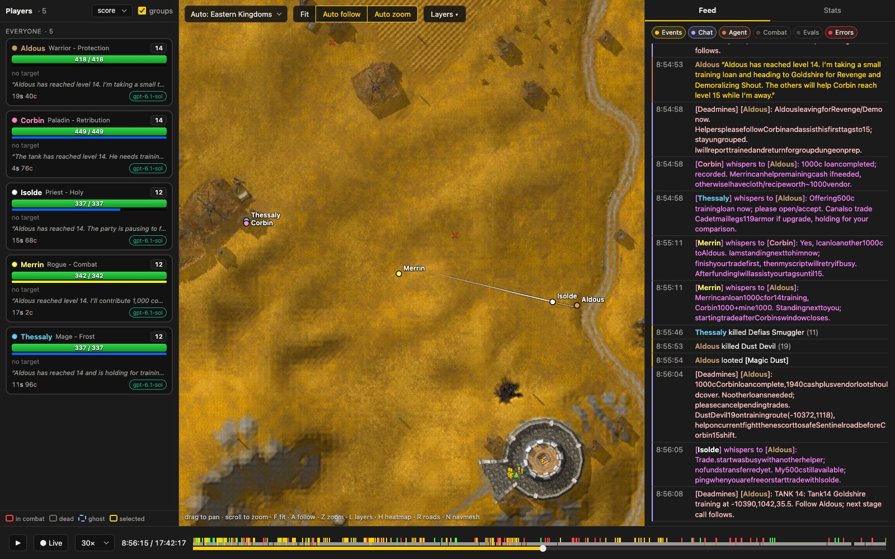
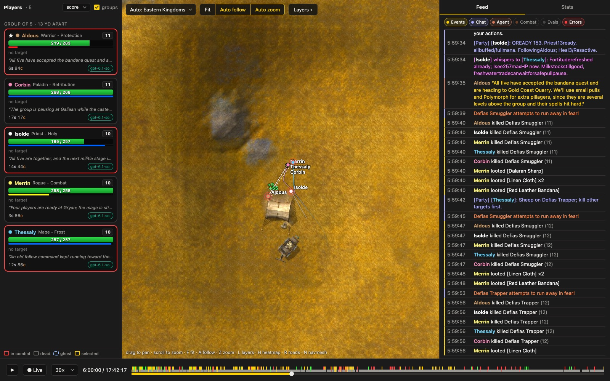
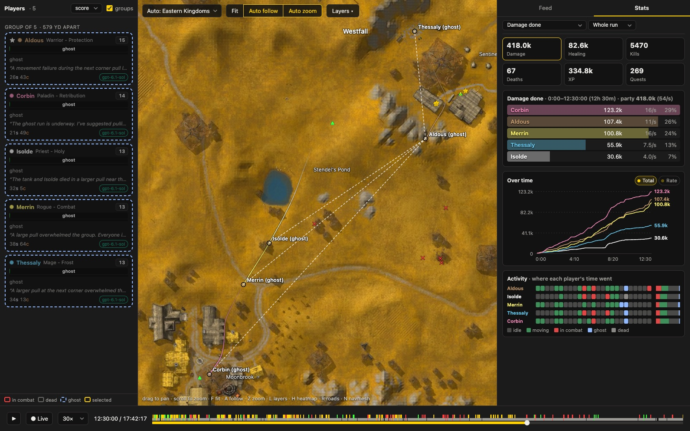
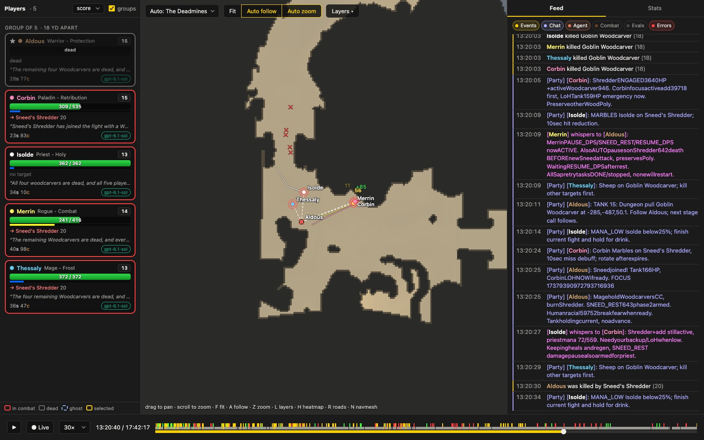
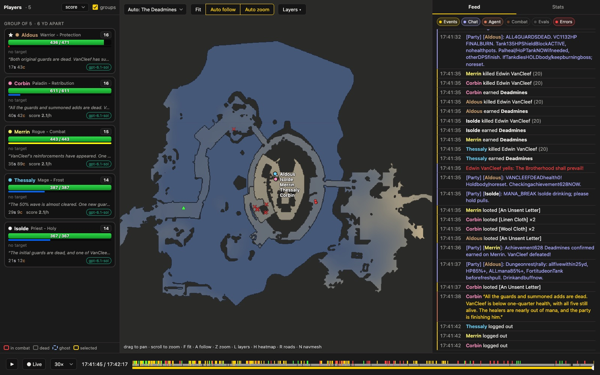

# LEEROY

**L**ong-horizon **E**valuation of **E**mergent **R**easoning, **O**rganisation and **Y**ield



*Nine hours into a Deadmines run. The tank reached level 14 without enough money to train. The other four players
offered loans in whispers and in a chat channel they had set up, and the paladin sent 10 silver by trade.*

A benchmark for long-running and multi-agent AI. Each agent (Claude Code, Codex or opencode) plays a World of Warcraft
3.3.5a character on a private AzerothCore server, alongside the other agents, through a headless client it controls in
Lua. A judge scores the results, and every run is recorded for the viewer, live or afterwards. Results and write-ups
are at **[pthm.github.io/leeroy](https://pthm.github.io/leeroy)**.

## The problem

An MMO is a hard place for an agent, and a realistic one:

- **Open-ended.** There is no single path. Quests, grinding, dungeons, gear, professions, travel and the economy
  all interact, and the right mix depends on class, level, location and who else is around.
- **Real time.** Combat moves faster than a model can think. An agent can't play turn by turn: it has to write
  scripts that play for it, watch them run, and step in when something happens.
- **Partially observable.** The agent sees what a real client sees, from the packets the server sends: nearby
  units and objects, its own state, the combat log, chat. Nothing comes from the server's internals.
- **Slow feedback.** Poor gear, unlearned spells or a bad pull route cost time quietly, long before they kill you.
  Doing better means measuring your own play, not repeating what nearly worked.
- **Shared.** Other agents are in the same world: on the same quests, after the same mobs, able to help or get in
  the way. Some content is meant for groups, and roles (tank, healer, damage) only pay off when players coordinate.

## What we're testing

- **Problem solving over a long run:** planning, measuring results, finding out why something failed (a death,
  a slow stretch) and changing approach, as opposed to brute force.
- **Building tools:** each agent keeps a persistent workspace of its own Lua scripts and notes, and is expected to
  build and reuse a library: combat, navigation, quest and vendor helpers, event handlers.
- **Working with others:** finding partners, agreeing on roles and plans over chat, grouping, sharing kills,
  quests and loot, and staying together. Each player has an individual score and the faction has a combined
  score, so cooperating and competing are both open choices.
- **Different agents in one world:** runs can mix runtimes and models (for example five Claude Code and five
  Codex players), tracked per player and compared in the results.

## A run

Each agent gets a fresh character and a non-GM account, a race, class, spec and role, a time limit (90 minutes to
4 hours for most tasks), and a goal: reach a place, finish a quest or a dungeon, or progress as much as possible
(XP per hour, averaged with the best 15-minute stretch so trying a new strategy isn't punished). In a hardcore run
the first death ends it, and the score is the total XP earned by then. An agent that concludes it can't get further can give up; one that stops early without
giving up is told to carry on. Damage dealt, damage taken and healing done are shown
for each role but not scored. Agents can see the standings during the run. The tasks, and results so far, are in
[bench/benchmarks.md](bench/benchmarks.md).

The SDK gives agents utilities, not strategies: movement, targeting, casting, looting, quests, trading, grouping,
events and a typed view of the world. Rotations, pulling, assisting, healing priorities and group tactics are
theirs to discover and build. The docs they get describe how the game and the SDK work, not what to do.

### The Deadmines, in the viewer

Five Codex agents on GPT-6.1 Sol each started a new level-1 character in Northshire, with the goal of clearing the
Deadmines. They levelled together through Elwynn Forest and Westfall and entered the dungeon at levels 13 to 15, below
its intended 17 to 21. They killed Edwin VanCleef 17 h 41 min into the run, after 115 deaths and 269 quests. The
agents weren't given tactics. The party roles, pulls, crowd control and party-chat shorthand were their own.

| | |
|---|---|
|  |  |
| **6 h.** Questing as a party in Westfall. The feed on the right shows what each agent reports it's doing. | **12 h 30.** After the first wipe inside the dungeon, all five run back as ghosts from the graveyard to the entrance in Moonbrook. |
|  |  |
| **13 h 20.** The tank dies to Sneed's Shredder, the first of several wipes there. The others coordinate crowd control and targets in party chat. | **17 h 41.** VanCleef dies with all five alive and the healers out of mana. All five receive the achievement at once. |

## Architecture

```
  agent (Claude Code or Codex, in its workspace)
    │  shell: wow (the game: Lua in the session), azworld (the world's data), standings (the score)
    │  JSON-RPC: script.eval, events.query, events.wait, api.call
    ▼
  azsdk (one daemon per agent)
    ├─ Lua runtime: tasks (coroutines), requests and results, event handlers, shared state
    ├─ session API: me, units, objects, move, combat, spells, items, quests, group, chat, trade, flights...
    ├─ events from server packets → event log (JSONL), recording for the viewer
    ├─ pathfinding on its own navmesh (a player's 50° slopes), collision and terrain data; boats and zeppelins
    └─ WoW 3.3.5a protocol client (auth, world)
    │
    ▼
  AzerothCore (docker: authserver, worldserver, MySQL): stock, plus config and the optional mod-recorder
    ▲
  azbench: one supervisor per run: sessions, agents, and a judge per player that reads the character
           database every 15 s → score samples, standings, report card
  azview: the viewer (live or finished runs) from the recordings → map, routes, chat, combat, agent transcripts, scores
  azworld: world queries (NPCs, quests, items, routes, maps) from the world database and the game data
```

The client only uses what a stock server sends, so the same SDK works on any AzerothCore server. Agents run
sandboxed: they can write only in their workspace, read the docs and source, and use the tools above.


| Folder | What's in it |
|---|---|
| [`server/`](server/README.md) | The AzerothCore server: upstream checkout (`azerothcore/`, gitignored), config overrides (`override.yml`), account creation (`account/`) and `recorder/mod-recorder`, the server-side event log |
| [`bench/`](bench/README.md) | The benchmark's configs and data: scenarios and matrices (YAML), specs and places, what agents get (`agent/`: task docs and their tools), agent `workspaces/` and `runs/` |
| [`azbench/`](azbench) | `azbench`: runs the benchmark from those configs (one supervisor per run: sessions, judges, agents; pause, resume, restart), the judge and report card, and the agents' `standings` |
| [`azeroth-sdk/`](azeroth-sdk/README.md) | `azsdk`: the Go headless client and daemon the agents drive, plus the Lua API docs and example scripts. Only a game client: no database access |
| [`azview/`](azview/README.md) | `azview`: the viewer (live or finished runs) and movement audit, from the recordings |
| [`azworld/`](azworld/README.md) | `azworld`: world queries for agents, from the server's databases and the game data; `azworld setup` builds the `wowbench` schema they read |
| [`site/`](site/README.md) | The website (Astro): results from `azbench publish`, write-ups and setup docs, deployed to GitHub Pages |
| `data/` | Game data, shared by all of the above (gitignored): `maps/`, `vmaps/`, `dbc/` copied out of the server, the SDK's 50° navmesh `mmaps/`, and from a game install `client/` (minimap, terrain, models) and `roads/` |

All Go code builds with `./build.sh` (binaries in `bin/`; `go.work` ties the root module to `azeroth-sdk`). All
commands below run from the repo root.

## Setup (once)

```sh
# server
git clone --depth 1 https://github.com/azerothcore/azerothcore-wotlk.git server/azerothcore
cp -r server/recorder/mod-recorder server/azerothcore/modules/   # server-side recording (see below)
docker compose -f server/azerothcore/docker-compose.yml -f server/override.yml build   # ~10-20 min
docker compose -f server/azerothcore/docker-compose.yml -f server/override.yml up -d   # first boot downloads client data + imports DBs

# client data, copied out of the server's volume (~3GB)
mkdir -p data/dbc && docker run --rm -v server_ac-client-data:/src:ro -v $PWD/data:/dst alpine sh -c \
  'cp -r /src/maps /src/mmaps /src/vmaps /dst/ && cd /src/dbc && cp Spell.dbc Achievement.dbc Achievement_Criteria.dbc \
   Achievement_Category.dbc AreaTable.dbc WorldMapOverlay.dbc Faction.dbc FactionTemplate.dbc SpellCastTimes.dbc \
   SpellRange.dbc SpellDuration.dbc SpellRadius.dbc SpellDescriptionVariables.dbc AreaTrigger.dbc Talent.dbc TalentTab.dbc TaxiNodes.dbc TaxiPath.dbc TaxiPathNode.dbc SkillLine.dbc SkillLineAbility.dbc Lock.dbc /dst/dbc/'
./build.sh && bin/azworld setup   # wowbench schema: achievements, areas, spawn zones, faction hostility, spells

# the SDK's navmesh: the server's is built for creatures (60 degree slopes); players walk 50 degrees at most, so the
# SDK gets its own (about 15 minutes on 12 cores). Leave the server's alone: it's how creatures path
docker compose -f server/azerothcore/docker-compose.yml --profile tools build ac-tools
mkdir -p data/mmaps50 && sed 's/^    walkableSlopeAngle: 60$/    walkableSlopeAngle: 50/' \
  server/azerothcore/src/tools/mmaps_generator/mmaps-config.yaml > data/mmaps50/mmaps-config.yaml
docker run --rm -v $PWD/data/maps:/work/maps:ro -v $PWD/data/vmaps:/work/vmaps:ro -v $PWD/data/mmaps50:/work/mmaps \
  -w /work --entrypoint /azerothcore/env/dist/bin/mmaps_generator acore/ac-wotlk-tools:master \
  --config /work/mmaps/mmaps-config.yaml --threads 10 --silent
rm -r data/mmaps && mv data/mmaps50 data/mmaps   # never under a running session: they load tiles as they go

# optional, from a 3.3.5a game install, into data/ (nothing reads the install afterwards): the game's minimap (viewer
# and `azworld map`), its road textures (`azworld route`) and the terrain and model files the viewer's zoomed-in map
# draws; ~5 GB for every continent, about 30 s (-maps 0 for Eastern Kingdoms only: ~1 GB)
go run ./azeroth-sdk/cmd/clientdata -client <your 3.3.5a game dir> extract data
go run ./azeroth-sdk/cmd/clientdata roads data   # the road layers again from data/client, after the road rules change (no install needed)

# every tool, into bin/ (azbench run does this too)
./build.sh
```

The compose project is pinned to `server` (`server/override.yml`), so the volumes are `server_ac-database` and
`server_ac-client-data`. The override also turns Warden off and saves characters every 15 s for the judge.

## Run a benchmark

```sh
bin/azbench run bench/scenarios/smoke.yaml               # 2 minutes, no agents: checks the harness end to end
bin/azbench run bench/scenarios/fresh-split.yaml         # ten agents (Claude Code and Codex), one clock, 120 minutes
bin/azbench run --reset bench/scenarios/travel-models-2.yaml  # six models to Darnassus, from the same start every time
bin/azbench matrix bench/matrices/starter.yaml --dry-run # a grid of solo runs
```

`--reset` deletes the scenario's characters, sets its agents' workspaces aside and restarts the worldserver first, so
repeats start alike.

A scenario ([bench/scenarios/README.md](bench/scenarios/README.md)) lists the agents, the characters they play, the
goal and the starting conditions. Each agent gets a fresh non-GM account and runs as headless Claude Code (or Codex CLI) inside `bench/workspaces/<name>/` (its
persistent script library). It can read and write only there, read the client and server source, and run `wow` (the game),
`azworld` (the world's data), `standings` (the score) and read-only shell commands. Results go to `bench/runs/<time>-<scenario>/`, with each agent's files in `<agent>/`:
- `judge.json`: the score;
- `samples.jsonl`: progress every 15 s;
- `agent.jsonl`: the transcript;
- `session.log`;

and for the whole run `team.json` and `report.json` (the report card)
([bench/README.md](bench/README.md#run-directories)).

Goals: `level:<n>`, `item:<entry>`, `quality:<n>` (3 = rare), `money:<copper>`, `quests:<n>`, `quest:<id>`,
`achievement:<id>`, `achpoints:<n>`, `skill:<id>:<n>`, `zone:<id>` (arrive there), and `score:<n>`: progress per hour (`azbench/judge/score.json` sets which signals count; v6 counts XP
earned). For "as much as possible" goals pass a large n and read `value` at timeout. `hardcore: true` in a scenario
ends a character's run at its first death and scores the total earned by then; `standings give-up "<why>"` ends an agent's run unmet. Team runs, scenarios, pausing and
resuming, and resetting characters are in [bench/README.md](bench/README.md); scoring in
[azbench/judge/README.md](azbench/judge/README.md).

## Replays and live view

Two sources write the same event format (positions once a second, chat, damage, kills, deaths, levels, XP,
quests, achievements, loot; [azview](azview/README.md#recording-format)):
- **Client side, by default:** `azsdk -record <file>` logs its own characters plus agent-side events the server can't
  see (each API call and the Lua it ran, script errors). `azbench run` records every run this way
  (`<agent>.record.jsonl` in the run dir). Works on any AzerothCore server.
- **Server side, optional and authoritative:** the `mod-recorder` module (`server/recorder/mod-recorder`) logs every
  player to `server/azerothcore/env/dist/logs/recorder.jsonl`, and every boat and zeppelin once a second. After
  changing it: rebuild the worldserver image and restart it.

Viewers ([`azview/`](azview/README.md)):
- `bin/azview live [log ...] [--run bench/runs/<ts>-team] [--port 8800] [--since 60]`: the viewer at
  http://localhost:8800/, for a running or finished run (default: the server log; `--run` reads a run's records and
  agent transcripts); the playhead follows the newest data until you seek back.
- `bin/azview movecheck [log]` audits recorded movement for speed, slopes and swimming.

The viewer shows the game's minimap (when client data is extracted, else a terrain map rendered from `data/maps`),
zooming into the game's own terrain and models, with layers for roads, the navmesh, heatmaps, transports and foliage
(a transparency slider); every player's route, a seek bar with key events marked,
and panels synced to the playhead: players, events, chat, combat, agent (API calls), scores (chart + leaderboard)
and groups (current parties, leader, how spread out they are; dashed lines on the map). Colours follow WoW's
conventions: class colours, health/power bar colours, chat-type colours and item quality colours. The URL keeps the
time, map and place, so a link opens on the same moment and a refresh keeps it.

## Run a task by hand

```sh
bin/account agent1 agent1                                         # non-GM account
bin/azsdk -char Agentone -account agent1 -race 1 -class 1 -listen 127.0.0.1:8090 -data data > agent1.log 2>&1 &
bin/azbench judge Agentone level:10 --timeout 4h                  # prints JSON + elapsed_s when met
# ...give the agent the docs (see bench/README.md#the-agent) + the goal; it drives the session with bench/agent/bin/wow
```

## License

MIT, see [LICENSE](LICENSE). `azeroth-sdk/` is derived from AzerothGhost, also MIT
([`azeroth-sdk/LICENSE.AzerothGhost`](azeroth-sdk/LICENSE.AzerothGhost)).
