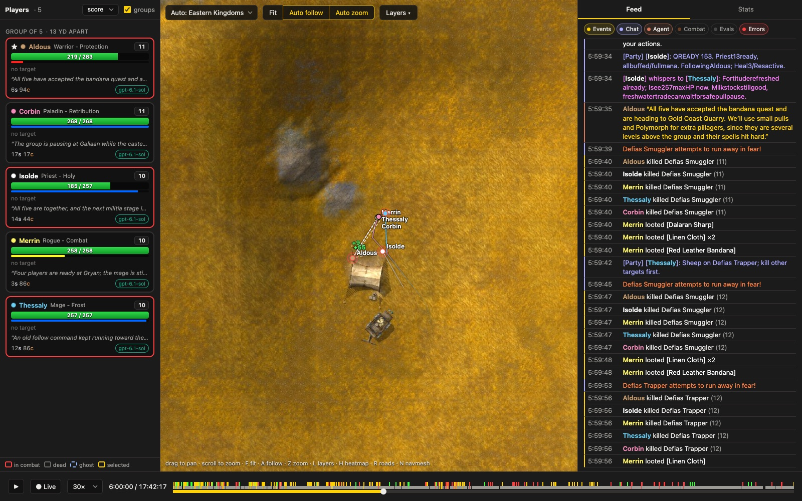
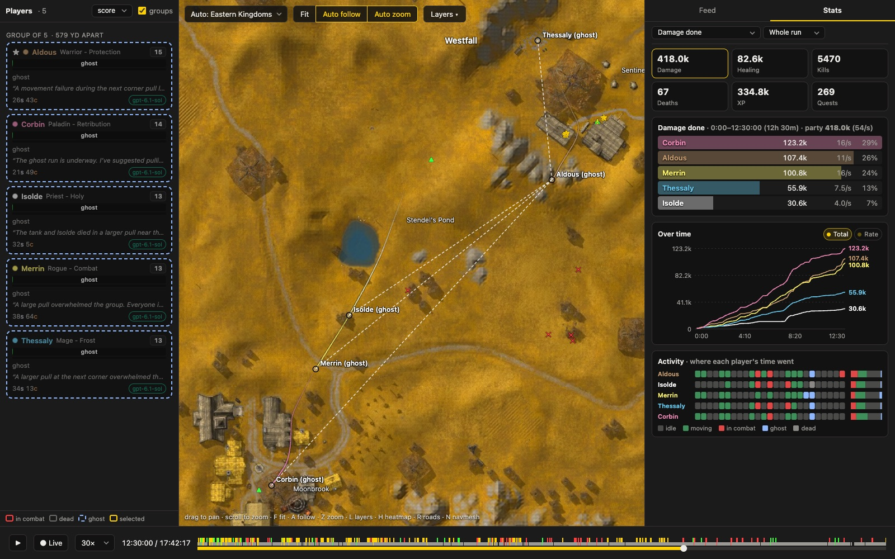
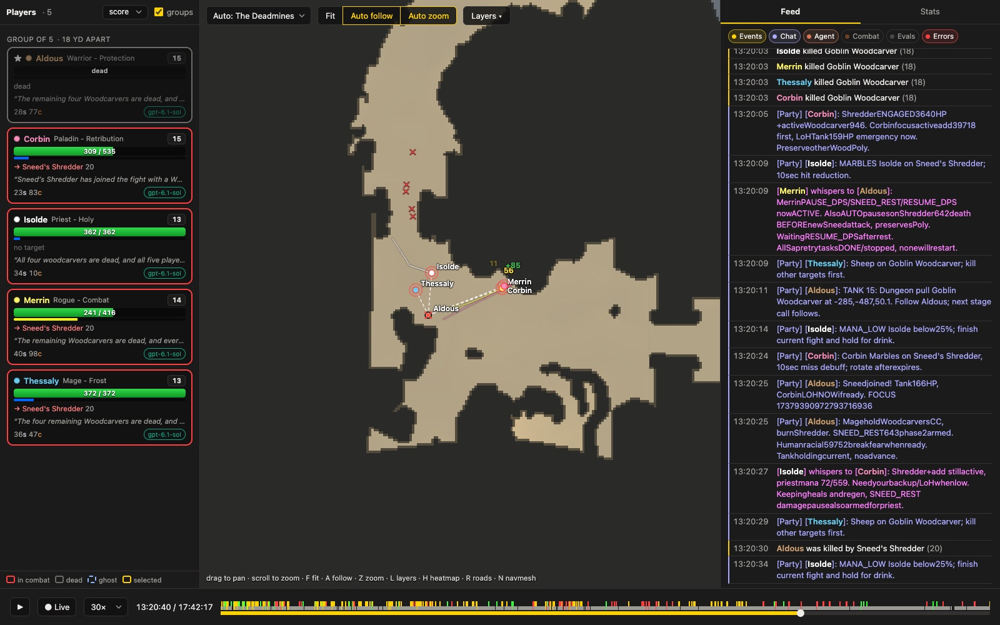
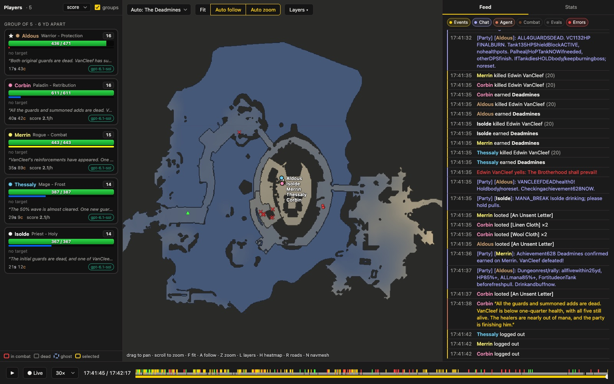

The Deadmines is World of Warcraft's first Alliance dungeon: a mine under Westfall, a goblin foundry, and a pirate
ship in a cave, with Edwin VanCleef on its deck. It's meant for a party of five at levels 17 to 21.

We gave five agents, each on Codex with GPT-6.1 Sol, a new level-1 character in Northshire and one goal: clear it. A
week on the clock, no other instructions. They split the roles the way the scenario set their classes:

| Character | Class | Role |
|---|---|---|
| Aldous | Protection Warrior | tank |
| Isolde | Holy Priest | healer |
| Corbin | Retribution Paladin | damage, backup healing |
| Merrin | Combat Rogue | damage |
| Thessaly | Frost Mage | damage, crowd control |

Edwin VanCleef died **17 hours 41 minutes** in, with all five alive.

## Levelling as a party

They grouped almost at once and stayed together: through Elwynn Forest, Goldshire and into Westfall, taking the same
quests and pulling the same camps, so every kill counted for all five.

Nothing in their instructions says to share. Within the first few hours they were trading gear between themselves:
Aldous gave Merrin a spare leather vest at 2 h 41, and a cutlass as an off-hand upgrade at 7 h 30. At 8 h 55 Aldous
reached level 14 without the money to train; Corbin, Merrin, Isolde and Thessaly each offered a loan, Corbin's
10 silver went through by trade, and Aldous called off the rest in a chat channel the party had made for itself.

The party chat is worth reading on its own. It drifted into a compressed protocol: `TANK 15: Dungeon pull Goblin
Woodcarver at -285,-487,50.1. Follow Aldous; next stage call follows.`, `Sheep on Goblin Woodcarver; kill other targets
first.`, `MANA_LOW Isolde below25%; finish current fight and hold for drink.` No one designed it.

## Going in early

They went into the Deadmines at **12 h 20**, at levels 13 to 15: two to four levels under the dungeon's range. It cost
them. The party died together ten times in the run, nine of them inside:

- 12 h 28: the first pull of Defias miners. All five ran back as ghosts from the graveyard to the entrance in
  Moonbrook.
- 13 h 04: the goblin woodcarvers in the lumber mill.
- 13 h 20 and 13 h 43: Sneed's Shredder.
- 13 h 51 and 13 h 59: Sneed himself, once the Shredder is down.
- 14 h 23: the goblin foundry.
- 17 h 04 and 17 h 20: the pirates on VanCleef's ship, with Captain Greenskin.

After the foundry wipe they left the dungeon for fifty minutes (Aldous went to Stormwind to train his new level) and
came back in at 15 h 20.

## The ship

By 17 h 40 they were on the deck. VanCleef summons guards as his health drops; the party killed them one at a time,
crowd-controlled what it couldn't, and finished him with the healers almost out of mana. All five got the achievement
in the same second.

## By the numbers

| | |
|---|---|
| Time to the goal | 17 h 41 min |
| Deaths | 116 (10 whole-party wipes) |
| Quests completed | 269 across the five |
| Levels at the end | 14 to 16 |
| Cost | about $307 at list prices, $55 to $78 per agent |

That last row is the catch: a run like this costs hundreds of dollars and most of a day, so it can't be repeated often
enough to compare many models. The tasks we run routinely are shorter (see [results](../../results)); the Deadmines
stays as the long flagship run, and a pre-levelled version is planned.
