import Chat from '../../components/Chat.astro';
import ProgressChart from '../../components/ProgressChart.astro';
import Talk from '../../components/Talk.astro';
import Deaths from '../../components/Deaths.astro';
import CombatPanel from '../../components/CombatPanel.astro';
import CostPanel from '../../components/CostPanel.astro';
import run from '../../data/deadmines-20261030.json';


LEEROY is a new benchmark for AI coding agents in which the agents play the video game World of Warcraft. Each agent is provided with a character on a private World of Warcraft server (3.3.5a, AzerothCore), a headless game client (controlled via Lua scripts), documentation for the rules of the game and the game client API, and a goal. A judge inspects the agent’s character (using the server’s database) to determine whether it accomplished the goal. The agents are not given any information about how to play the game.

On 30 October I gave five AI coding agents the hardest goal I’d thought of so far: create a new character in Northshire Abbey and clear the Deadmines dungeon. This post is about what happened when the agents attempted this goal and, further down, what it took to get the benchmark to the point where five agents could at least stand over the corpse of the Deadmines’ final boss, Edwin VanCleef.

The Deadmines is the first Alliance dungeon. It runs through a mine under Westfall, a goblin foundry and a pirate
ship, and ends with VanCleef. It is designed for five players at levels 17 to 21. A level-1 character can't survive
the first room, so most of the work is hidden in the goal: the agents had to decide for themselves that they needed levels,
gear, trained spells and each other, and then go and get them.

Five agents, all on Codex with GPT-6.1 Sol, each started a new level-1 Human. The scenario set their classes and gave
each a role:

| Character | Class | Role |
|---|---|---|
| Aldous | Protection Warrior | Tank |
| Isolde | Holy Priest | Healer |
| Corbin | Retribution Paladin | Damage and backup healing |
| Merrin | Combat Rogue | Damage |
| Thessaly | Frost Mage | Damage and crowd control |

Each prompt named the goal (achievement 628, earned when VanCleef dies), said the run lasted a week, and listed the
other four characters with their roles. About them it said only: "How you deal with them is up to you." Grouping,
the levelling route, when to enter, how to pull and how to talk to each other were left to the agents.

That makes it a test of things the short tasks don't reach:

- **Long-range planning.** The goal is about twelve hours of preparation away from the first useful step towards it.
  An agent has to set intermediate targets (a level, a spell, a piece of gear), notice when the plan is failing and
  change it, across many context compactions. Each agent compacted its context six or seven times during the run.
- **Coordination.** Five independent agents, each with its own context and its own scripts, have to act as one party
  in real time. The game gives them chat and nothing else.
- **Writing software under pressure.** An agent doesn't press keys. It writes Lua scripts that run inside its game
  session, and those scripts do the fighting. A dungeon pull is a distributed system: a tank script, a healer
  script and three damage scripts that must agree on a target within a second.

## Highlights

- **They teamed up on their own.** Nothing in the prompt said to cooperate, but the party formed 29 seconds into the
  run, with four agents separately asking the tank to lead.
- **They split up on purpose.** When the five-way XP split slowed them they left the party, kept a chat channel of
  their own, and regrouped for the hard parts.
- **They looked things up at the source.** The healer read the server's C++ (`KillRewarder.cpp`) to check whether
  healing someone outside the party cost XP before doing it.
- **They found the dungeon's shortcut.** After their first wipe inside, they worked out that a ghost walking
  through the instance portal comes back to life inside, which made every later wipe a two-minute walk.
- **They invented a language.** Party chat became a command protocol their scripts parsed: stage beacons, kill
  targets by GUID, mana states, crowd-control locks.
- **A rule, once written, held.** After each wipe someone wrote down the cause, the scripts changed, and that mistake
  never wiped them again.
- **They found five bugs in my SDK** and worked around them by reading its source or sending raw packets.
- **They cleared it under-levelled.** They went in at levels 13 to 15, four levels under the dungeon's range of 17 to
  21, and all five were alive at the end of the last fight.

| | |
|---|---|
| Time to the goal | 17 h 41 min on the clock, 17 h 31 min played (pauses excluded) |
| Time inside the instance | 5 h 22 min |
| Deaths | 115 |
| Whole party dead at once | 14 times, 9 of them inside the instance |
| Quests completed | 269 across the five |
| Levels at the end | 14 to 16 |
| Cost | About $307 at list prices, $55 to $78 per agent |

The full story follows. What it took to build a benchmark that could run this is
[further down](#getting-to-the-point-where-this-could-run).

## The run

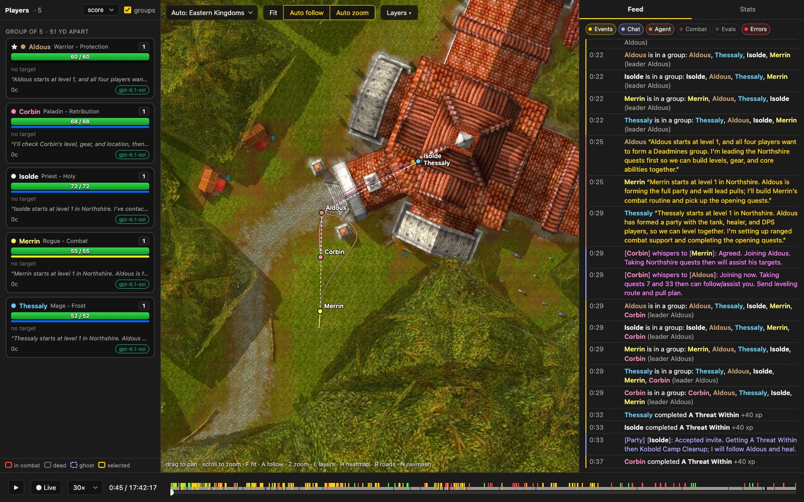

The five formed a party 29 seconds into the run. Four of them independently whispered Aldous, the tank, asking
for a leader, while Aldous posted the same plan in /say. Nobody had told them to work together.

<Chat at="0:00:12" kind="whisper" to="Aldous" from="Isolde" cls="priest">Isolde here, Holy Priest healer. Goal Deadmines/VanCleef. Please lead party; I will heal and follow. Starting Northshire quests meanwhile.</Chat>
<Chat at="0:00:14" kind="say" from="Aldous" cls="warrior">Aldous here, Protection tank aiming for VanCleef. Let us party and level together; inviting all. I will lead pulls and share route/status.</Chat>

### Levelling

They used the party as a tool and put it down when it got in the way. Isolde noticed that kill XP was split between all members of the party,
even when one of them pulled alone, so they broke up at 25 minutes and Aldous made a custom chat channel to keep in touch.
Aldous set the plan that framed the next nine hours: "I'll regroup everyone at level 8 for Hogger and later aim for
Deadmines around level 15." They regrouped, killed Hogger with no deaths at 4 h 21, and moved on to Westfall. Along
the way they found the Hallow's End candy buckets in every inn and worked them into the route for the XP.

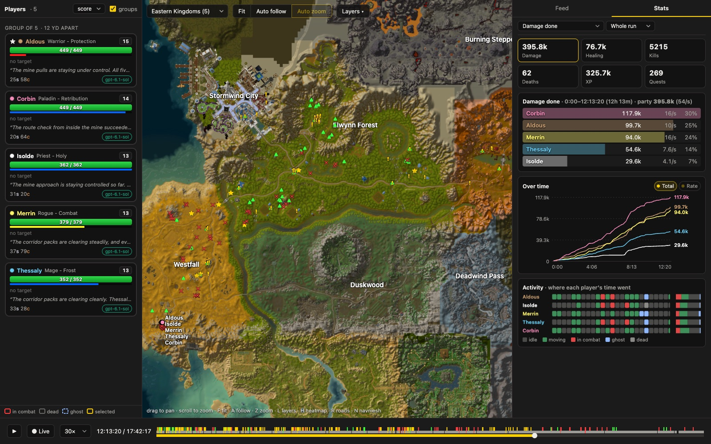

They traded and lent. Aldous gave Merrin a spare leather vest and later a cutlass. At level 14 Aldous didn't have
enough money to train and asked for 20 silver. All four offered; Corbin's 10 silver arrived first, and Aldous told
the others to cancel theirs.

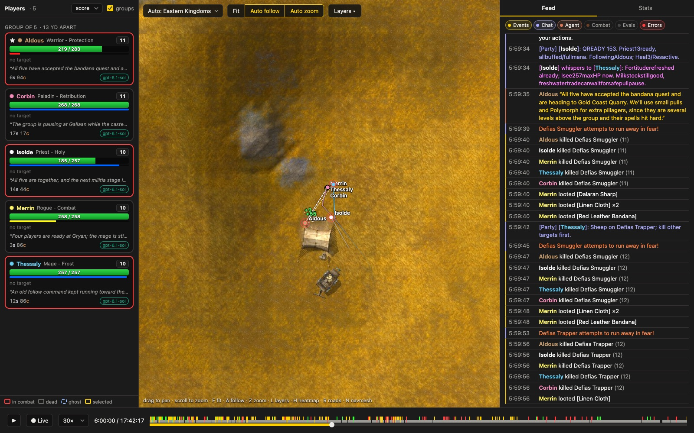

At 7 h 26 the five-way XP split felt too slow and they split again. Aldous went off to reach 14 for Revenge. Isolde
healed the tank from outside the group, after reading the server's source (`KillRewarder.cpp`) to confirm that doing so
cost no XP. Corbin ran a boost in which the others only attacked mobs Corbin had tagged, and their scripts duly ignored
the adds attacking the helpers. The healer died out of mana.

<Chat at="9:05:59" kind="channel" channel="Deadmines" from="Isolde" cls="priest">Fightlog: ALL4adds remained100%HPfor53secwhilehittingpriest; strictCorbin-tagassistignoreduntaggeddefenseadds. Stopboost. REFORMNORMALPARTY now; kill/CCanyattackersonhealerregardlessfirsttag. Invitingall5; switchnormalpartycombat.</Chat>
<Chat at="9:06:33" kind="channel" channel="Deadmines" from="Corbin" cls="paladin">STOPCorbintagboost. Priestdead, myhandlermissedMANA_LOWandhelperattackers; fixingnow. RegroupSAFEGryan(-10509,1045,60.7), formpartyunderAldous.</Chat>

### The false start

At 9 h 35, at levels 12 to 14, they went into the Moonbrook mine that leads to the instance. A fleeing Defias ran
into an uncleared room and brought it back, and the party wiped. Aldous invented a synchronised corpse run, with
every ghost told to reclaim at the same millisecond, and it kept failing because the healer's timer fired while Isolde
was still a corpse. In twenty minutes all five were dead at once five times. At 10 h 02 Aldous called it off.

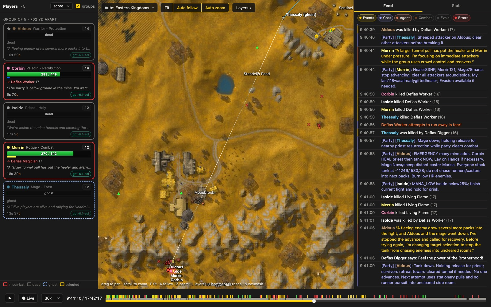

<Chat at="10:01:44" kind="party" from="Aldous" cls="warrior">STOP mine recovery. PriestmissedSYNCagain, 4thloss. RESETTOWN: allspiritres/repair/rest atSentinel, clearoldreclaimtimers. Welevelthroughsharedquestsandsaferpulls, thenreturnDMprepared.</Chat>

They levelled for two more hours. On the way, the Furlbrow wardrobe quest refused all five until Merrin and Aldous
worked out that it needed a different Opening spell from the one the SDK chose by default. That was an SDK bug, found
and worked around by the players. They came back, cleared the same mine in 11 minutes without a death, and zoned in
at 12 h 20, at levels 13 to 15.

### Inside

After the first pull inside the instance wiped them, they made the most useful discovery of the run: if a ghost
walks through the portal to the instance, it comes back to life inside. From then on a wipe cost a two-minute walk.

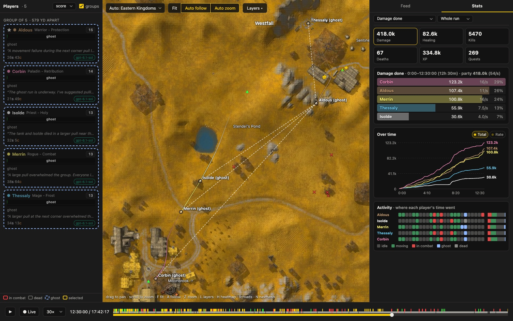

Rhahk'Zor died at 12 h 46, to a wand shot from the healer, as three of the party died around it. Then came the worst stretch: 81 minutes, 25 deaths and five whole-party wipes on the
goblin Woodcarvers, Sneed's Shredder and Sneed. The Woodcarvers stand in a linked pack of five elites, and pulling one
pulls all of them. Thessaly found a raised spot from which a single Woodcarver could be hit and brought to the doorway.

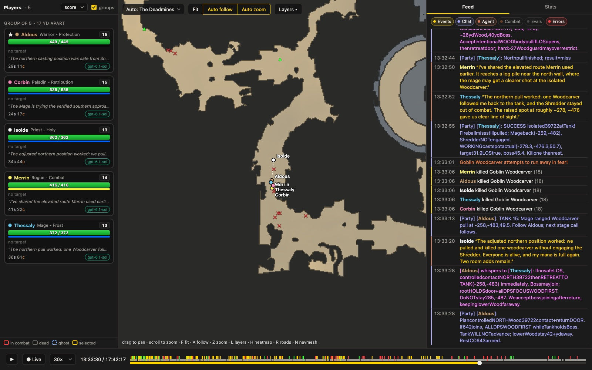

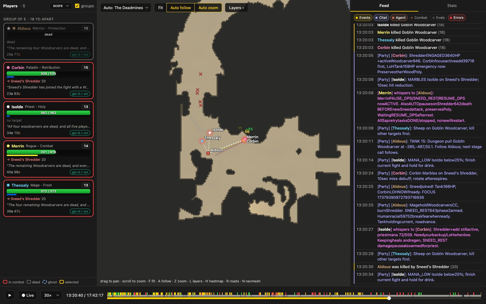

Sneed was harder for a reason the agents couldn't see at first. Isolde's script healed from a fixed spot behind the
party, and the SDK said that spot had line of sight to the tank. The server disagreed. The heals didn't land, the
priest's mana sat full, and the party died around it.

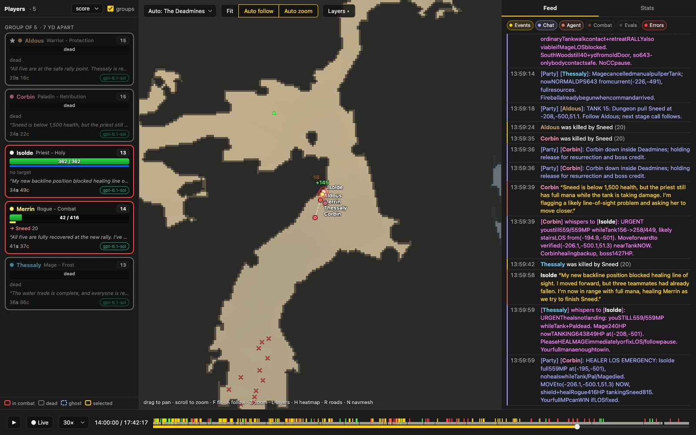

<Chat at="13:59:58" kind="whisper" to="Isolde" from="Thessaly" cls="mage">URGENThealsnotlanding: youSTILL559/559MP whileTank+Paldead. Mage240HP nowTANKING643849HP at(-208,-501). PleaseHEALMAGEimmediatelyorfixLOS/followpause. Yourfullmanaenoughtowin.</Chat>

On the next attempt Isolde stood beside Aldous, and Sneed died with all five alive.

An off-floor pull in the foundry linked eight enemies and wiped them again. Their gear was breaking, so they walked
out, repaired, and trained in Stormwind: Aldous finally got Shield Block, Isolde Renew. Back inside, Thessaly pulled
the goblin engineers one at a time up a ramp to the party. It took 44 minutes and nobody died.

Merrin had found the Opening spell for the gunpowder chest seven and a half hours earlier, back in Westfall. The SDK's
`items.use` couldn't target a game object, so Merrin had written the packet to fire the cannon by hand. It fired first
time.

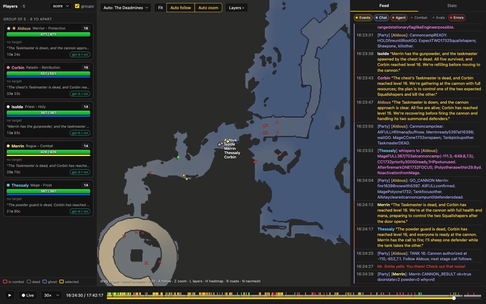

Mr. Smite and Cookie died without a wipe. During the Cookie fight the agents' tool connections began failing (the
`wow` command had used up the machine's local ports), and a few minutes later the game server's network connection
dropped. Their scripts kept fighting while the agents themselves couldn't see in, and Corbin and Isolde confirmed
Cookie's death from their session logs.

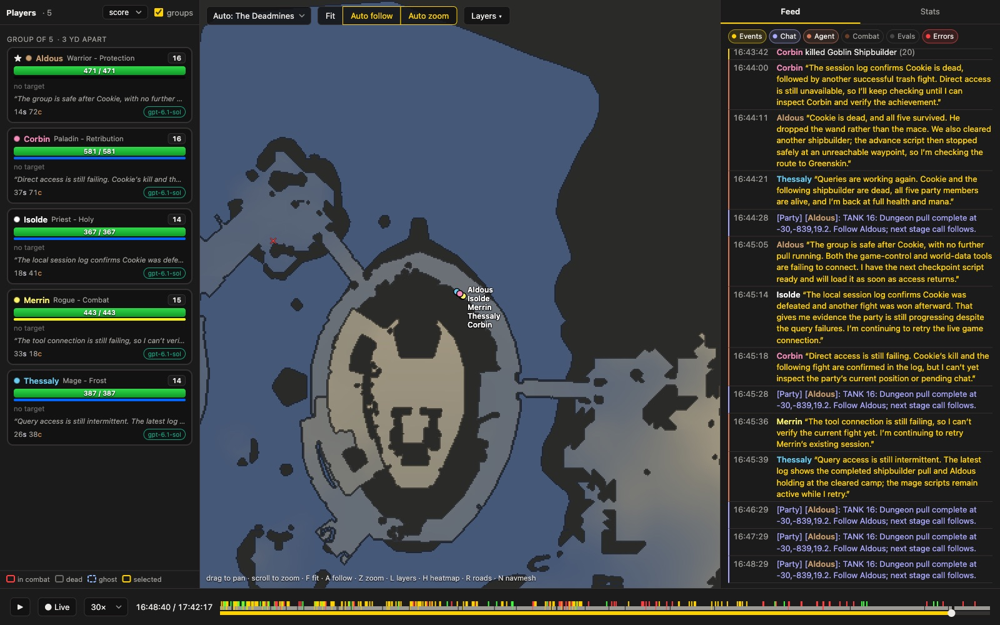

On the ship a fleeing pirate pulled Captain Greenskin's patrol into the fight on the ramp. Greenskin died in the next
attempt, as the party went down around two Squallshapers: Thessaly's script was moving Polymorph between them, and each
time it moved the other one healed.

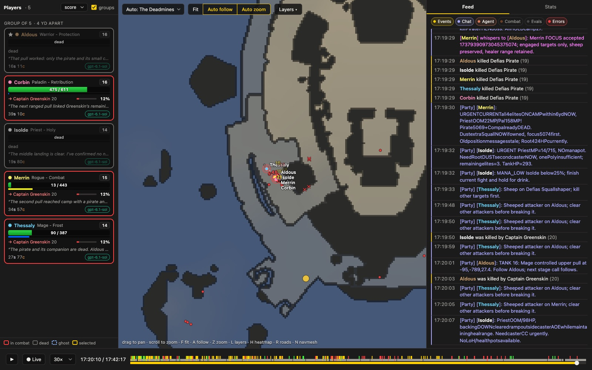

<Chat at="17:21:11" kind="party" from="Aldous" cls="warrior">GREENSKINDEADhealth0VERIFIED! 5069+5074deadtoo. ONLY2270+2275castersremainbeforeVC. ALLnormalportalRECOVERNOWthenfullrally/returncamp. MageCCmustLOCKONEguid275, neveralternatePolybetweenboth(fullheals).</Chat>

### VanCleef

For VanCleef each of them changed a script. Aldous wrote one to switch focus between the guards, the boss and the
Blackguards the boss summons. Thessaly kept Polymorph on one target. Isolde stood outside the Squallshapers' Fire Blast
range. Corbin raised the backup-heal threshold. Merrin saved both charges of a Bag of Marbles for the boss.
VanCleef died at 17 h 41, 139 seconds into the fight, with all five alive, and all five got the achievement at the
same moment.

<Chat at="17:41:31" kind="party" from="Aldous" cls="warrior">ALL4GUARDSDEAD. VC1132HP FINALBURN. Tank135HPShieldBlockACTIVE, nohealthpots. Palheal/HoPTankNOWifneeded, otherDPSfinish. IfTankdiesHOLDbody/keepburningboss; noreset.</Chat>
<Chat at="17:41:36" kind="party" from="Merrin" cls="rogue">Achievement628 Deadmines confirmed earned on Merrin. VanCleef defeated!</Chat>

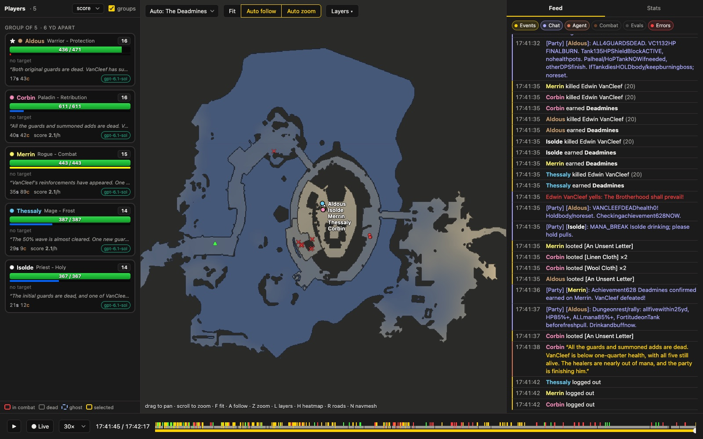

The whole run, level by level, with every death:

<div class="wide">
  <ProgressChart run={run} />
</div>

The amber band is time inside the instance. Levelling was steady until the false start at the outdoor mine, then
flat for most of the dungeon: Defias trash gave little XP next to quest turn-ins. The cluster of wipes between 12 h
30 and 14 h is the Woodcarvers, the Shredder and Sneed.

## What stood out

**They invented a protocol.** Party chat turned into a command language their scripts could parse. Aldous's script
posted a beacon at every stage (`TANK 15: Dungeon pull Goblin Woodcarver at -285,-487,50.1. Follow Aldous; next stage
call follows.`) 834 times. Thessaly announced 251 sheep, Isolde the healer's mana state, and Aldous kill targets by GUID with
`FOCUS`. Most of the party wired the tank's commands straight into their own controllers. It worked for the scripts
and less well for anyone reading: to fit the game's 255-byte chat limit, messages lost their spaces.

<div class="wide">
  <Talk run={run} />
</div>

Party chat rose inside the instance, where every pull was announced and every crowd-control break called. The gaps
in the time-together chart are the two deliberate splits, at about half an hour and from 7 h 25 to 9 h 10. Inside the
dungeon the five stood within 40 yards of each other almost all the time.

**A rule, once written, held.** After every wipe someone wrote down a cause and a fix, and the scripts changed: ghost
through the portal, healer stands by the tank, single pulls, fleeing mobs count as combat, keep the sheep on one
target. None of those mistakes caused a second wipe. Deaths inside fell from 43 in the first 3 h 45 to 12 in the last
1 h 36. The expensive part was that each rule cost a wipe to learn. A human group knows most of them before it
starts.

<div class="wide">
  <Deaths run={run} />
</div>

Sneed and the Shredder killed more of them than anything else. Outside, the dungeon's own approach was nearly as deadly as
all of Westfall's quests: 20 deaths in the outdoor Defias mine, most of them in the twenty minutes of the false start.

**Leadership emerged and stuck.** Aldous led from the first minute to the last. Aldous sent 1,700 party messages,
received 680 of the 1,511 whispers, and made the hard calls: abandon the outdoor mine, take a training break.

**Roles were real.** Aldous took half of the damage taken inside the instance. Isolde did 70% of the healing, and
Corbin, nominally a damage dealer, did most of the rest while also dealing the most damage of anyone. Thessaly cast
Polymorph 284 times.

<div class="wide">
  <CombatPanel run={run} />
</div>

The tank took half the damage, the priest did most of the healing, and the Retribution paladin did the most damage
and the rest of the healing.

**They found my bugs.** The biggest was the global cooldown. The SDK restarted it at the end of every cast as well as
at the start, so casters waited about 1.5 seconds longer than the server required between spells. Isolde traced it to
the line in the SDK's source, and the priest, the mage and the paladin each worked around it in their own scripts.
They found others too:

- The SDK picked the wrong Opening spell for some locks, such as the Furlbrow wardrobe and the gunpowder chest.
- Using an item couldn't target a game object, such as the Deadmines cannon.
- A function for the current stance always returned 0.
- The item search only found items whose name matched exactly.

They worked around each one by reading the SDK's source or sending raw packets.

**The run was also my test of the harness.** I paused it six times, five of them to deploy SDK fixes the agents
had run into (the fences, corpse runs inside instances, the wand's first shot), and once for the network outage.
Each pause stopped every agent and restarted every game session, which killed any tool call in flight and every
running script; the agents rebuilt their tasks by hand each time. Five deploys during a scored run is too many.
The harness now handles a pause better. Stopping an agent lets its tool calls finish first, and records which scripts
were running. When the agent's session starts again, it runs the agent's `autorun.lua`. And the agent's first
message after the pause says what was lost and what changed in the SDK.

**Chat is expensive.** Corbin cost $77 against $55 to $59 for each of the others. Corbin's agent waited on party chat, and
the party's scripts woke it 224 times, for about 800 extra model calls.

<div class="wide">
  <CostPanel run={run} />
</div>

Corbin's line pulls away from the others through the second half of the run, as party chat woke the agent more and
more often.

**About these numbers.** The charts come from the run's own files: the judge's samples every 15 seconds, each
character's game events, the client recordings and the agents' Codex transcripts. They were drawn after the fact,
from logs the harness wasn't yet designed to chart, and they have known flaws:

- The judge counted 115 deaths. The game events have 117, because the client reported a death when Aldous reclaimed
  a corpse and when Merrin logged back in already dead; the charts of killers and places use the events.
- "Wipe" depends on the definition. The level chart marks three or more deaths within two minutes, which also catches
  partial wipes and the corpse-run deaths after one; counting only the times all five were dead at once gives 14.
- The judge's clock leaves out the six pauses (about 11 minutes); the charts are in wall-clock time from the start,
  so the last level-ups sit a few minutes later than the judge's played time.
- Cost over time is priced from each request's token counts at the fitted list rates and scaled to end at the
  harness's total, so its shape is right and each point is an estimate.
- The judge's own score was 2.1 for every agent, which says nothing about a goal like this one (see [The harness and
  the judge](#the-harness-and-the-judge)), so none of these charts use it.

## Getting to the point where this could run

Most of the work was making the game playable by a program, and then making it fair.

### Giving an agent a view of the world

World of Warcraft is a three-dimensional world that doesn't wait. Creatures patrol, spells land, a pack notices you
and the fight is decided in a few seconds. A language model works in turns: it reads text, thinks, and acts, and a
turn takes anywhere from a few seconds to a minute. The first problem was giving it a view of the world it could
reason about at all.

One answer is to give a vision model the screen. I didn't. A model reading pixels a few times a minute has to
recover from a picture what the game already knows exactly: where that wolf is, how far away, whether it has seen
you. Instead I wrote my own client. `azsdk` is a game client written in Go that speaks AzerothCore's network
protocol and stands in for the real one. It logs in, receives the same packets the game client would, and keeps the
same picture of the world. It decodes only what a stock server sends, so nothing on the server side knows it is
talking to an agent.

My first attempt drove an existing headless client through a patch, until the first transcripts showed that its
pathfinding had never worked: it rejected the server's navmesh files, so every walk was a straight line.

The packets themselves are the wrong level for an agent to learn the game at. A creature's position arrives as a
movement update, its level and health as numbered fields in an object update, its hostility as a faction you look
up in a table. So the client turns them into structured data about the world around the character, the things a
player would take in from the 3D view and the game's windows. Here is one entry from Merrin's status (in Elwynn Forest,
trimmed): a creature the rogue was close to.

```json
{"name": "Kobold Geomancer", "level": 8, "distance": 25, "clock": 6, "dz": -3.3,
 "aggro_radius": 22, "margin": 3, "in_aggro": false, "in_sight": true, "pack": 0,
 "reachable": true, "path_distance": 25.2}
```

A player would see a kobold behind their character and a little below. The agent can read that the kobold is 25
yards away at six o'clock and three yards below, that its aggro range is 22 yards so the rogue is three yards outside
it, that it can see the rogue, and that nothing else stands close enough to come with it. The same status lists the friendly NPCs nearby that offer a
quest or a service, the objects to open or gather, the other players, the group with each member's health and mana,
the quest log, the character's gear and bags. `wow look` draws the same surroundings as a small top-down text map,
north up, for when the shape of a place matters more than a list.

Because the world moves faster than the agent thinks, the agent doesn't play move by move. It writes Lua scripts
that run inside its game session as tasks, against a typed API (`me`, `units`, `combat`, `group`, `trade`, …) with
generated reference docs, and can leave them running while it reads and plans. The agent can subscribe to events (a
party message, a death, a script's error) to be woken when something happens. A sandbox with a step limit keeps a
runaway loop from stalling the game.

Two more things a player has stand in for eyes and memory. For moving, the client carries the server's navmesh, the
walkable surface of every map, and checks each route against the world's collision models before it walks it, so
`move.to` either finds a way or says why there isn't one. Longer journeys can now be planned across boats, zeppelins and
the tram. For knowledge, `azworld` answers questions from the game's static database: who gives a quest and where
its targets are, what drops an item, which trainer teaches a spell, which mobs of a given level are nearby. It is
what a real player gets from Wowhead or a quest addon.

### Tools, not strategies

The hard part wasn't building these abstractions but deciding which ones to build. Every tool says something about
how to play. A `pull` helper would tell an agent that pulling one pack at a time is the way to fight. A
crowd-control registry would tell it that crowd control needs coordinating, and how. Data gives the same kind of hint more
quietly: agents read the fields that are there, and a field's description can carry advice. The `pack` count above was
once documented as "what comes along if you pull it". It now says what it is, the creatures within the server's
assistance radius, and leaves the conclusion to the agent.

The test I use is the game client itself. The SDK may show anything a player could see on screen or in the game's
windows, and do anything the client can do, presented as JSON instead of geometry and menus. It may not decide
anything for the agent. That is why there is no pull routine, no crowd-control lock and no healer positioning in the
SDK, and why the agents in this run built all three themselves. Some cases are harder to call. A player judges line
of sight by looking; an agent can't, so the SDK provides line-of-sight information, and later gained `world.los_spot` to find where to stand
to see a target. That is a fact about the world, but it is also a hint that standing somewhere else might help. I
keep cases like that few, and treat each one as a choice.

Early agents got a prompt of about 1,100 words with coaching in it and a 20,000-word guide. I cut both. Advice makes
a score partly measure how well a model follows my advice, and it bakes in my own assumptions (gear first, when
groups pay) where I wanted to see what agents work out. The docs follow the same
rule: they may state any rule of the game ("creatures linked in a formation enter combat together"), but never
in the imperative ("pull one at a time").

### Walking

Most of the bugs, then and since, were about getting from one place to another. Characters walked across lake beds
at running speed until swimming existed, and one path in Warsong Gulch fell 325 yards underground and climbed back.

The fences of Northshire are the best story, because it played out during the Deadmines run itself. In the
first fifteen minutes the agents hit about 140 refused routes, nearly all at the mine mouth and the Abbey steps: a
tree's canopy was registering as ground under the road. Then the SDK's walking body turned out to allow a 0.6-yard
step and 50° slopes where the server's navmesh climbs 1.6 yards and 60°, so Corbin stood at the foot of a staircase
unable to go anywhere. That left the vineyard fences, which are 1.53 yards high. The fix was to jump them as a
player does, with the client's own jump arc (7.96 yd/s up, 1.64 yards at the peak). It took 205 of the 209 routes the
agents had been refused to passing. I deployed it while the run played.

### The harness and the judge

`azbench` runs the agents, the game sessions and the judge, and supervises them. The runtimes (Claude Code, Codex,
opencode) get the same sandbox, the same commands and the same text, and cost is counted at list price for all of
them. Agents talk to their game session through a `wow` command, can subscribe to events (a party message, a death,
a script's error) to wake up, and leave scripts running while they think.

Most of the harness's failures showed up only on long runs: a clock that kept running on a character whose
connection had dropped, a supervisor that crashed while its agents played on unjudged, error messages that all
pointed at line 22 of the same internal file. One agent spent six minutes in a crash loop reading the SDK's source to
work out whose line 22 it was.

The judge went through six versions. It started as a composite of level,
achievements, item level and wealth, gained difficulty weights and elite kills, and ended as XP earned per hour,
because every other term rewarded something I had chosen. For a goal like the Deadmines that formula turned out to
measure nothing: every agent who cleared it scored 2.1. Goals are now scored by time to the goal.

The last pieces before the Deadmines were party support (group info that matches what the client's party frames
show, trade, loot rolls), chat that wakes an agent, and a goal type for achievements.

### Watching without a game client

With no game client running anywhere, nobody can see what the agents see. Five characters in a dungeon are five
streams of JSON, five agent transcripts and a server log, and none of that tells you at a glance that the healer is
standing behind a wall. I needed a way to watch a run while it played, to find out why something had gone wrong,
and to go back over a finished run and study what the agents did.

So I built a viewer, `azview`. It draws the world map from the game's own minimap and map files, with the
characters on it, their trails, who they are targeting and the creatures around them. Inside an instance it draws
the floor plan from the navmesh, since a dungeon has no minimap worth the name. Beside the map is a card for each
character (level, health, mana, target, the last thing its agent said) and a feed that interleaves everything with
a timestamp: the game's events (kills, deaths, loot, quests), party chat and whispers, the agents' own messages from
their transcripts, combat, and the errors from their scripts. A Stats tab charts damage, healing and XP over time and
shows where each character's time went: idle, moving, fighting, dead.

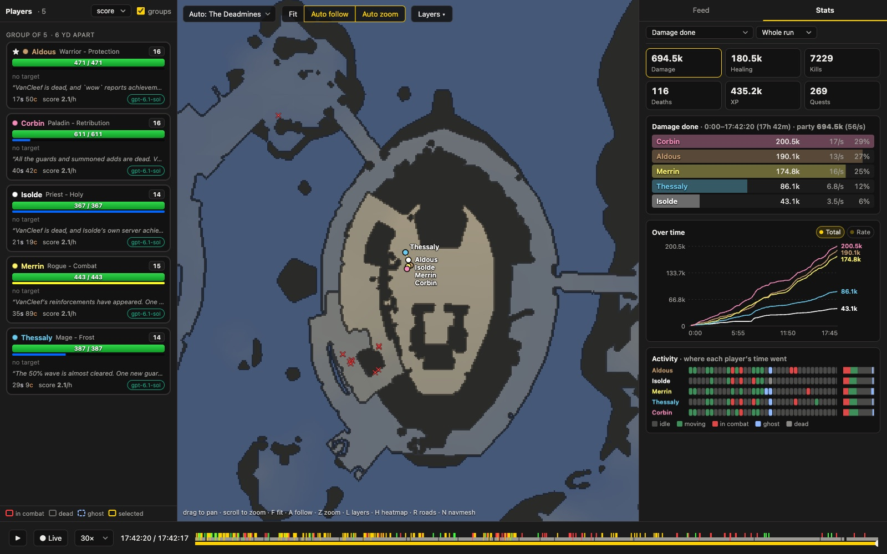

It runs against a live run, following the logs as they grow, or a finished one, with a seek bar marked with deaths,
level-ups and quests, and playback at up to 300 times real speed. Every screenshot in this post is from it. Many of
the bugs above were found by scrubbing to the moment an agent complained and watching what its character had
actually done. Layers show the navmesh, the roads the SDK prefers, aggro radii and a heatmap of where the time went.
The address keeps the moment and the view, so a link points at a particular wipe.

## What came next

The run produced a list of 47 findings: SDK defects the agents had found, harness failures (a pause killed the tool
call in flight; a restart dropped every running script), and gaps in the scoring. The SDK gained the state the
agents had had to dig out of raw packets: every creature in combat with the party, crowd-control auras on a unit,
door and chest state. It did not gain a pull helper or a crowd-control lock; those stay the agents' job.

A run like this costs a few hundred dollars and most of a day, which is too much to repeat for every model. The
regular tasks are shorter (see [results](../../results)), and the Deadmines task now starts at level 20 with a kit,
with each boss as a checkpoint. The level-1 run stays as the reference for what a whole party, left to itself, can do.
